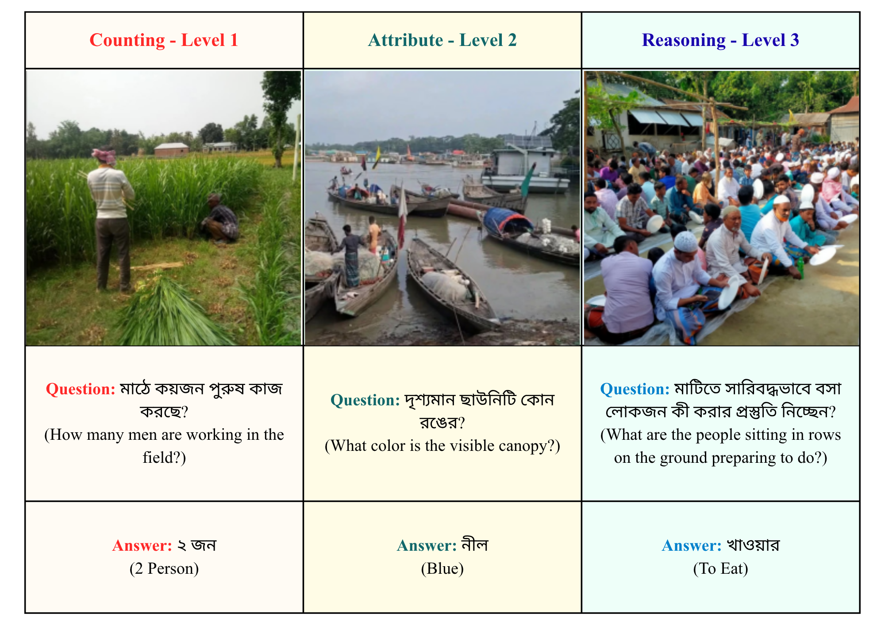
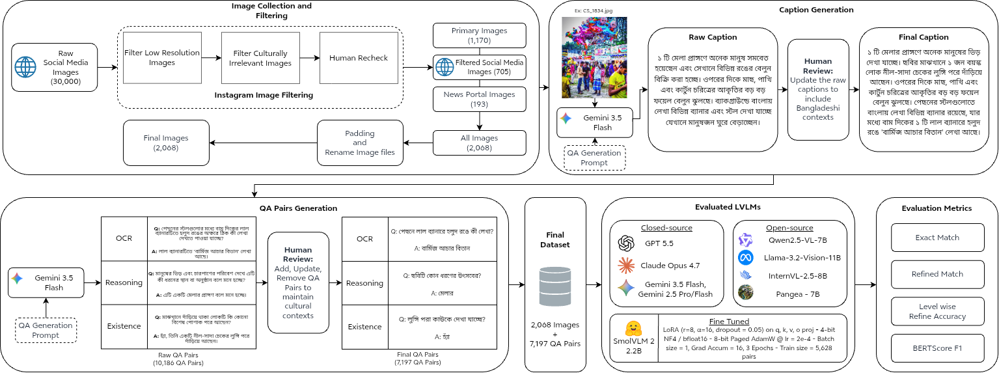

<!--
  BEFORE YOU PUBLISH — replace every [PLACEHOLDER] in this repo:
  see the "Before you publish" checklist at the bottom of this file.
-->

# BangladeshiVQA

**A culturally grounded Bangla Visual Question Answering benchmark.**

BangladeshiVQA is a native Bangla VQA benchmark of **2,068 Bangladeshi images** and
**7,038 open-ended question–answer pairs**, organized into **three cognitive levels** and
**seven image categories**. To our knowledge it is the **first Bangla VQA dataset with
dedicated in-image Bangla scene-text (OCR) questions**, and the first to split strictly by
image ID to prevent train/test leakage.

This repository accompanies the paper *"BangladeshiVQA: Evaluating Geo-Cultural and Tiered
Multimodal Reasoning in Bangladeshi Context."* It contains a **preview sample of the
dataset**, the **caption/QA-generation and Gemini
evaluation code**, and the **SmolVLM2 fine-tuning configuration and LoRA adapter**. The
**full dataset — all 2,068 images, 7,038 QA pairs, and the train/val/test splits — is hosted
on Hugging Face** (see [Download](#download)).

- 📄 **Paper:** [PAPER_LINK_OR_DOI]
- 🤗 **Full dataset on Hugging Face:** https://huggingface.co/datasets/tanim494/BangladeshiVQA
- 📦 **Dataset DOI:** [10.57967/hf/10089](https://doi.org/10.57967/hf/10089)
- ⚖️ **License:** Annotations under [CC BY-NC 4.0](LICENSE); images remain under original ownership (non-commercial academic use). See [NOTICE](NOTICE.md).

> **Note on naming.** During development this dataset was called *ChitroSamagra*. It has
> been renamed **BangladeshiVQA**; older drafts or artifacts may still use the former name.



<p align="center"><em>Example question–answer pairs across cognitive levels — Counting (Level 1), Attribute (Level 2), and Reasoning (Level 3). Questions and answers are in Bangla; English glosses are shown for reference only.</em></p>

---

## Highlights

- **Native, not translated.** Images are photographed or sourced in Bangladesh, capturing
  local attire, transport, cuisine, festivals, and Bangla signage — not machine-translated
  Western imagery.
- **Tiered reasoning.** Every question is tagged with a cognitive level (Perception →
  Representation → Cognition), letting you pinpoint *where* a model breaks down.
- **In-image Bangla OCR.** The first Bangla VQA benchmark with dedicated scene-text
  questions over Bangla script.
- **Leak-free splits.** Data is split by unique **image ID**, so no image appears in both
  train and test.
- **Reproducible evaluation.** Gemini evaluation scripts, metric implementations
  (Exact Match, Refined Accuracy, BERTScore F1), and fine-tuning configs are released here;
  the full prompt set is in the paper's Appendix A.3.

## Dataset at a glance

| | |
|---|---|
| Images | 2,068 |
| QA pairs | 7,038 |
| Splits (by image ID) | train 5,628 · val 704 · test 706 |
| Cognitive levels | 3 (Perception, Representation, Cognition) |
| Question types | Existence, Counting, Attribute, Reasoning, OCR |
| Image categories | 7 |
| Language | Bangla (Bengali) |
| QA pairs / image (mean) | 3.40 |
| Unique answers | 1,524 |
| Unique vocabulary tokens | 4,218 |
| Mean question length | 5.87 words (33.56 chars) |
| Mean answer length | 1.44 words (6.16 chars) |

### Question taxonomy (QA pairs)

| Level | Question type | Count | Share |
|---|---|---:|---:|
| **Level 1 — Perception** | | **3,245** | **46.11%** |
| | Existence | 2,069 | 29.40% |
| | Counting | 1,176 | 16.71% |
| **Level 2 — Representation** | | **3,280** | **46.60%** |
| | Attribute | 3,280 | 46.60% |
| **Level 3 — Cognition** | | **513** | **7.29%** |
| | Reasoning | 375 | 5.33% |
| | OCR | 138 | 1.96% |

Levels are derived from question type: Existence/Counting → Level 1, Attribute → Level 2,
Reasoning/OCR → Level 3. The hierarchy is designed so each level isolates one capability
over the previous — a model must *detect* an object (L1) before it can *describe* it (L2),
and understand a scene before it can *reason* about its cultural meaning (L3).

### Image categories (images)

| Category | Images | Share |
|---|---:|---:|
| Human Activities & Daily Life | 775 | 37.48% |
| Culture & Arts | 450 | 21.76% |
| Food & Cuisine | 306 | 14.80% |
| Geography & Places | 245 | 11.85% |
| Transportation | 149 | 7.21% |
| Flora & Fauna | 96 | 4.64% |
| Scene Text & Signs | 47 | 2.27% |

## Comparison with existing benchmarks

| Dataset | Images | QA Pairs | Image Source | Answer Format | OCR | Split | Generation Pipeline |
|---|---:|---:|---|---|:---:|---|---|
| Bengali VQA v1 | 500 | 5,000 | Translated (Western) | Binary (Yes/No) | ✗ | Question ID | Machine Translated |
| Bengali VQA 2.0 | 3,280 | 13,046 | Translated (Western) | Binary (Yes/No) | ✗ | Question ID | Machine Translated |
| Bengali CLEVR | 1,271 | 12,291 | Translated (Synthetic) | Open-ended | ✗ | Question ID | Machine Translated |
| Bangla-Bayanno | 4,750+ | 52,650 | Translated (MS COCO) | Open-ended | ✗ | Question ID | LLM-Assisted Translation |
| SEA-VQA | 515 | 1,999 | Native (Southeast Asia) | Multiple Choice | ✗ | — | LLM + Human Review |
| TaiwanVQA | 1,000 | 2,000 | Native (Taiwan) | Multiple Choice | ✗ | — | Manual Annotation |
| BVQA | 3,545 | 17,725 | Existing Datasets | Open-ended | ✗ | Question ID | GPT-3.5 + Human Validation |
| ChitroJera | 15,147 | 15,292 | Existing Datasets | Open-ended | ✗ | Question ID | GPT-4 Turbo + Human Validation |
| **BangladeshiVQA (Ours)** | **2,068** | **7,038** | **Native (Primary + Public)** | **Open-ended (Multi-Tier)** | **✓** | **Image ID** | **Gemini 3.5 Flash + Human Validation** |

## Dataset construction

BangladeshiVQA is built with a human-in-the-loop pipeline: images are collected and
filtered, Gemini 3.5 Flash drafts an objective Bangla caption and then candidate QA pairs,
and two expert native-Bangla reviewers validate, edit, and re-label every pair against the
image (10,186 raw pairs → 7,038 final). The caption/QA-generation code, the Gemini
evaluation and metric code, and the SmolVLM2 fine-tuning configuration are released in
[`code/`](code/).



<p align="center"><em>End-to-end pipeline: image collection and filtering → caption generation → QA-pair generation → evaluation across LVLMs and metrics.</em></p>

## Repository structure

```
BangladeshiVQA/
├── data/
│   └── sample_images/             # 21 preview images (3 per category) + sample_qa.json
│                                  #   (the full dataset lives on Hugging Face — see Download)
├── code/
│   ├── generation/                # caption_qa_generation.ipynb  (Gemini caption + QA drafting)
│   ├── evaluation/                # close_source_test.py (OpenRouter zero-/few-shot), llm_judge.py,
│   │                              #   evaluation_metrics.ipynb (exact / refined / BERTScore / level-wise)
│   └── training/                  # smolvlm2_finetuning.ipynb, finetuning_config.md,
│                                  #   smolvlm2_lora_adapter/ (fine-tuned LoRA weights)
├── examples/
│   ├── load_dataset.py            # summarize the bundled sample; fetch the full dataset from HF
│   └── explore.ipynb              # minimal viewer over the sample images
├── docs/images/                   # workflow + sample-QA figures
├── DATASHEET.md · NOTICE.md · TAKEDOWN.md · CITATION.cff · LICENSE
```

### Annotation format

In the full dataset on Hugging Face, each entry in `qa_pairs.json` and the split files is a
flat record:

```json
{
  "image_id": "CS_0001",
  "q_type": "Counting",
  "question": "কয়টি সিএনজি অটোরিকশা দেখা যাচ্ছে?",
  "answer": "২ টি",
  "level": "Level 1"
}
```

`image_id` matches the image filename (`CS_0001` → `CS_0001.jpg`). `q_type ∈ {Existence,
Counting, Attribute, Reasoning, OCR}`; `level ∈ {Level 1, Level 2, Level 3}`. The bundled
preview (`data/sample_images/sample_qa.json`) carries the same fields but groups the QA
pairs under each image.

## Download

This repository ships only a small **preview sample** (21 images + their QA pairs, in
[`data/sample_images/`](data/sample_images/)). The **full dataset — all 2,068
full-resolution images, the 7,038 QA pairs, and the train/val/test splits — is hosted on
Hugging Face** (too large for Git):

| Source | Link | Best for |
|---|---|---|
| Hugging Face Datasets | https://huggingface.co/datasets/tanim494/BangladeshiVQA | full images + annotations, programmatic loading |
| DOI (Hugging Face) | [10.57967/hf/10089](https://doi.org/10.57967/hf/10089) | citable, versioned reference |

On Hugging Face the layout is `images/CS_xxxx.jpg` plus `annotations/qa_pairs.json` and
`annotations/splits/{train,val,test}.json`.

```bash
# Requires: pip install huggingface_hub
# Download everything (images + annotations) into ./BangladeshiVQA
huggingface-cli download tanim494/BangladeshiVQA --repo-type dataset --local-dir ./BangladeshiVQA
```

## Quick start

```python
# The bundled preview sample — no download required.
import json, os
from collections import Counter

sample = json.load(open("data/sample_images/sample_qa.json", encoding="utf-8"))
qa = [{"image_id": img["image_id"], **p} for img in sample for p in img["qa_pairs"]]
print(len(sample), "sample images;", len(qa), "QA pairs")
print("Levels:", dict(Counter(r["level"] for r in qa)))

ex = qa[0]
print(ex["question"], "→", ex["answer"])
```

```python
# The full dataset from Hugging Face (set HF_DATASET_REPO to your repo id).
from huggingface_hub import hf_hub_download
import json

path = hf_hub_download(repo_id="tanim494/BangladeshiVQA", filename="annotations/qa_pairs.json",
                       repo_type="dataset")
qa = json.load(open(path, encoding="utf-8"))
print(len(qa), "QA pairs")   # 7038
```

See [`examples/load_dataset.py`](examples/load_dataset.py) for summarizing the sample and
downloading/verifying the full dataset, and [`examples/explore.ipynb`](examples/explore.ipynb)
for a viewer over the bundled sample images.

## Evaluation

Models are scored with four metrics, all implemented in
[`code/evaluation/evaluation_metrics.ipynb`](code/evaluation/evaluation_metrics.ipynb):

- **Exact Match** — correct only when the raw prediction equals the ground truth exactly;
  a strict lower bound.
- **Refined Accuracy** — normalizes prediction and reference before comparison (Bangla
  numerals → word forms, punctuation/space trimming, subset matching), so `"২"`, `"২ টি"`,
  and `"দুইটি"` all score correct against the same target. Focuses on Bangla surface-form
  (numeral/punctuation) variation.
- **BERTScore F1** — semantic similarity using `bert-base-multilingual-cased` (layer 9, no
  baseline rescaling). Treated as a signal of semantic relevance, **not** a correctness
  measure (it has a high floor for multilingual text).
- **Level-wise Refined Accuracy** — refined accuracy reported separately per cognitive level.

Refined Accuracy was validated against an LLM-as-a-judge (Gemini) check, with metric–judge
agreement of 91.50%–99.29% across model groups.

### Headline results (test split, Refined Accuracy)

| Model | Setting | Refined Acc. | Level 3 |
|---|---|---:|---:|
| GPT-5.5 | Few-shot | 83.54% | 73.08% |
| Claude Opus 4.7 | Few-shot | 82.72% | 75.00% |
| Gemini 3.5 Flash | Few-shot | 82.13% | 70.88% |
| Best open-source (Pangea-7B) | Few-shot | 38.81% | — |
| SmolVLM2-2.2B (fine-tuned) | Fine-tuned | 46.88% | 3.85% |

The best closed-source model leads the best open-source model by **~45 refined-accuracy
points**, and **no model exceeds 75% at Level 3 (Cognition)** — the benchmark's central
diagnostic finding. Gemini 3.5 Flash was used in the annotation pipeline, so its scores are
reported as a diagnostic signal rather than for ranking. Full per-type and error-analysis
tables are in the paper.

## License

- **Annotations** (questions, answers, type/level labels, splits) are released under
  **[Creative Commons Attribution-NonCommercial 4.0 International (CC BY-NC 4.0)](LICENSE)**.
- **Images** remain under their **original ownership** and are provided for
  **non-commercial academic research only**. See [NOTICE.md](NOTICE.md).
- To request removal of an image, see [TAKEDOWN.md](TAKEDOWN.md).

## Citation

If you use BangladeshiVQA, please cite the paper (see [CITATION.cff](CITATION.cff)):

```bibtex
@inproceedings{bangladeshivqa,
  title     = {BangladeshiVQA: Evaluating Geo-Cultural and Tiered Multimodal Reasoning in Bangladeshi Context},
  author    = {Ahsanul Karim Tanim and Durjoy Saha},
  year      = {2026},
  booktitle = {[VENUE]},
  note      = {Dataset: https://github.com/tanim494/BangladeshiVQA},
  url       = {[PAPER_LINK_OR_DOI]}
}
```

---
